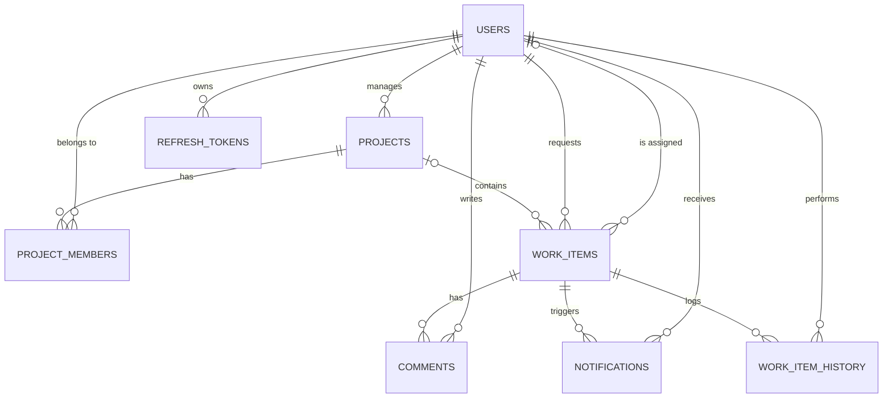

# Design decisions

This is a short write-up of why the project is built the way it is.

## 1. Stack in one paragraph

Next.js on the front, Express on the back, PostgreSQL as the database, Socket.IO for realtime. I use the `pg` library directly with parameterized SQL instead of an ORM. The queries here (visibility rules, filters, joins) are easier to read and to check as SQL than as ORM calls, and every value always goes through a `$1, $2 ...` placeholder, so SQL injection is not possible. The backend is split like this:

```
route -> validation (Zod) -> auth middleware -> controller -> service -> repository -> PostgreSQL
```

Controllers only deal with HTTP. Services hold the business rules. Repositories are the only place that contains SQL.

## 2. Database design



Tasks and tickets share one `work_items` table, with a `type` column. The rules that belong to the data are enforced by the database itself, not only by the application:

- a TASK must have a `project_id` (`CHECK`)
- a status must fit the type, so `ESCALATED` only exists for tickets (`CHECK`)
- priority is one of `LOW, MEDIUM, HIGH, URGENT`; roles, notification types and so on are `CHECK`s too
- emails are unique; a project name is unique per manager; a person can be a project member only once (composite primary key)
- `updated_at` is set by a trigger, so it is right whichever code path changes a row

**What happens when something is deleted** (this is what the foreign keys say):

| Relationship | On delete | Why |
|---|---|---|
| work item -> requester, project -> manager, comment -> author | `RESTRICT` | you cannot remove a person who still owns history. Users are deactivated instead of deleted |
| work item -> assignee | `SET NULL` | the item simply becomes unassigned |
| project member -> project | `CASCADE` | members go away with their project |
| comments, history, notifications -> work item | `CASCADE` | they have no meaning without the item |
| work item -> project | `RESTRICT` | projects are archived, not deleted |

Work items are **soft deleted** (`deleted_at`, admin only), so history and comments survive. Every query that lists items ignores them.

**Indexes:** the work item indexes are *partial* (only rows where `deleted_at IS NULL`), because that is what nearly every query reads. They cover project + status, assignee + status, requester, type + status + priority, due date and created date. Other indexes: notifications by `(recipient, is_read, created_at desc)`, comments and history by `(work_item_id, created_at)`, project members by user, refresh tokens by user and expiry.

**Search** uses `ILIKE '%text%'` on title and description. It matches parts of words, which feels right for a small tracker. At a bigger scale I would add a `pg_trgm` index.

**Migrations** are plain `.sql` files applied in order by a small runner. Each file runs in a transaction.

**Transactions:** things that must stay consistent are done in one transaction, for example "change the status, write the history row, create the notifications". The item row is locked with `SELECT ... FOR UPDATE` first, so two people editing the same item at the same moment are handled one after the other.

## 3. Access control

All rules are enforced on the backend. The UI also hides what you cannot do, but that is only for convenience.

1. **Route level:** `authenticate` plus a reusable `authorize('ADMIN', ...)` middleware for role-only endpoints (for example user management).
2. **Row level:** `visibilitySql(user)` returns the `WHERE` clause that says which work items a user may see. It is used by the list, the detail, update, delete, comments and history. A row you may not see is never read, so counts and pagination are correct too.
   - Admin: everything.
   - Manager: items in projects they manage or belong to, items they raised or are assigned, and tickets without a project (the support queue).
   - Member: items in projects they belong to, items they raised, items assigned to them.
3. **Field level:** `getUpdateScope()` returns `FULL` (admin, or the project's manager), `ASSIGNEE` (only status and description) or nothing.

If you cannot see an item the API answers **404**, so ids cannot be probed. If you can see it but may not do the action, it answers **403**. The user's role is read from the database on every request, so changing a role or deactivating someone takes effect immediately.

For the UI, `GET /work-items/:id` returns a `permissions` block (editable fields, allowed next statuses, can escalate, can delete, can comment). The screens render from that instead of repeating the rules in JavaScript.

### Status changes

The allowed transitions are in one file, `constants/statuses.js`, and are covered by unit tests. A wrong move returns **422** with the list of allowed next states.

- Task: `TODO -> IN_PROGRESS -> IN_REVIEW -> DONE`, with steps back, `CANCELLED`, and reopening `DONE`. Cancelling and reopening need a manager or admin.
- Ticket: `OPEN -> IN_PROGRESS -> RESOLVED -> CLOSED`, with `ESCALATED` reachable from open or in-progress. Leaving `ESCALATED`, closing, and reopening need a manager or admin.
- `CANCELLED` and `CLOSED` lock the item.

## 4. Notifications

1. A service action (assign, status change, comment, new ticket, escalation, the due-soon job) creates the notification rows **inside the same database transaction** as the change itself.
2. Only after the transaction has committed, the rows are pushed with Socket.IO to the room `user:<id>` of each recipient. A change that rolled back never produces a message.
3. Sockets are authenticated: the handshake must contain a valid access token, and inactive users are refused. A socket only joins its own room. Admins also join an `ADMIN` room for an audit feed. When a role changes or a user is deactivated, their sockets are disconnected.
4. When the app opens, it loads the saved notifications and the unread count over the normal API, then applies live events on top. So anything that arrived while the user was offline is still there. The `/notifications` page also lists older ones.
5. The "due soon" reminder is a cron job (every 15 minutes). It reminds the assignee and the project manager once per due date. Changing the due date or the assignee resets it. A nightly job removes notifications older than 90 days and expired refresh tokens.

Who gets what: assigned -> the new assignee; status change -> requester and assignee; comment -> requester and assignee; new ticket -> the project's manager, or every manager and admin for a ticket without a project; escalation -> manager/admins plus requester and assignee. The person who did the action is never notified about it.

## 5. Login and sessions

Passwords are hashed with bcrypt. The access token is a JWT that lives 15 minutes and is kept in memory by the browser. The refresh token is a random value in an httpOnly cookie; only its hash is stored in the database. It is single use: each refresh issues a new one, and if an old one is ever replayed, all sessions of that user are revoked. Login and register are rate limited. Public sign-up always creates a **member**; only an admin can change roles, and not their own.

## 6. Assumptions and trade-offs

- The brief said members comment on items "assigned to them or raised by them". I implemented exactly that: a member can read comments on any item they can see but can only post on items they are involved in. Managers and admins can comment on anything they can see.
- Members see every item in their projects (read-only unless assigned). A member can set a priority when raising a ticket, but not an assignee or due date.
- An assignee must be the project's manager or one of its members. A ticket without a project can only go to a manager or admin.
- Each project has one manager (`manager_id`). An admin who creates a project becomes its manager.
- Realtime tokens are checked when the socket connects. A very old connection is not checked again until it reconnects. Role changes and deactivation disconnect the user immediately, which covers the important case.
- Things I chose not to build: email notifications, file attachments, a drag-and-drop board, and the Redis adapter that would be needed to run several API servers.

## 7. Tests

`cd server && npm test` runs Jest and supertest against a real PostgreSQL test database. They cover:

- **Auth:** sign-up cannot make you an admin, duplicate emails, wrong password, bad tokens, deactivated users, refresh token rotation and reuse detection.
- **Access control:** who can see which projects and items, 404 versus 403, assignee limits, comment rules, admin-only delete, notifications can only be marked read by their owner.
- **Status transitions:** the allowed and the forbidden moves.
- **Database constraints:** the checks, unique keys and foreign key behaviour from section 2.
